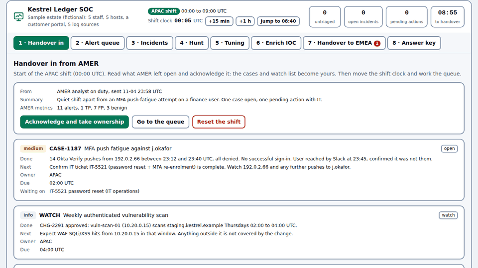

# SOC Shift

Work a fictional SOC shift in your browser: take the handover, triage Sigma and correlation alerts, pivot, respond, hunt, tune with a regression check, and hand over.

- **Try it:** [edwardtay.github.io/soc-shift](https://edwardtay.github.io/soc-shift/) (this repository on GitHub Pages)
- **Also live at:** [pwnsy.com/tools/detect/soc-desk](https://pwnsy.com/tools/detect/soc-desk/) (the version this repository was extracted from)



For SOC students who want reps on analyst decisions, instructors who want a shift they can set and grade, and SOC leads who want to see how someone triages and hands over. There is nothing to install, no account and no server: the page is static files, and the shift is saved in your browser.

## What you do in a shift

The bundled scenario is a nine-hour APAC shift (00:00 to 09:00 UTC) at Kestrel Ledger, a fictional crypto custody firm with five staff, five hosts, a customer portal and five log sources (EDR, SSE, WAF, IdP and CloudTrail style records, 65 events).

| Tab | What you do |
| --- | --- |
| 1 · Handover in | Read what the AMER shift left open and acknowledge it. The open case, its pending IT ticket and the watch list become yours. |
| 2 · Alert queue | Move the shift clock. Alerts arrive after their platform's pipeline delay (about a minute for EDR and WAF, five for scheduled SIEM searches), and opening one acknowledges it. Read the evidence, open the raw events, record a verdict (true positive, benign, false positive, escalate) with severity and a reason, and link it to an incident. |
| 3 · Incidents | Keep each incident's one-line summary, next action, owner, due time and IR notification current. See its response log and merged timeline. Set the IOC flag, TLP 2.0 level (including AMBER+STRICT) and PAP on each observable, then export the incident as a TheHive case, DFIR-IRIS alerts or a STIX 2.1 bundle. |
| 4 · Hunt | Run Sigma hunts over the whole event lake for what no alert caught, or write your own. Hits show whether an alert already covered them and can be added to an incident. |
| 5 · Tuning | Propose a filter for a noisy rule. The proposal is built from the fields that separate your false and benign positives from your confirmed alerts, then the rule is re-run over the lake and blocked if it would drop a true positive. |
| 6 · Enrich IOC | Look up an IP, domain, npm package or CVE against public sources. |
| 7 · Handover out | A handover note built from your verdicts, incidents, pending actions, watch list and tuning requests, and a check that lists what the next shift would lose time on. Shift timing shows MTTD, MTTA, MTTR and time to first response from the shift clock. Copy the note, download it as Markdown, or download the shift as NDJSON verdicts, an ATT&CK Navigator layer or a STIX 2.1 bundle. |
| 8 · Answer key | Compare your verdicts with the key, see what each hunt should find, and read the incidents a good shift ends with. |

Click any entity (user, host, IP, domain, package, customer, session, cloud key, file) to open its timeline across every source, run live lookups and take response actions. Actions the SOC can do itself complete at once; actions owned by another team (password reset, key deactivation, account lock, DLP case) stay pending and carry into the handover.

### Exports and shift timing

| Export | Where | What it holds |
| --- | --- | --- |
| TheHive case JSON | Incidents | The case (TheHive 5 `InputCase`) with response actions as tasks, observables with IOC, TLP and PAP, each linked alert as an `InputAlert`, and ATT&CK procedures |
| DFIR-IRIS alerts JSON | Incidents | One alert per linked alert, with IOCs, assets (hosts by OS, accounts), severity and status ids |
| STIX 2.1 bundle | Incidents, Handover out | The SOC as an identity, an indicator and a sighting per IOC, ATT&CK attack-patterns and `indicates` relationships. Ids are deterministic, so the same shift exports the same bundle |
| ATT&CK Navigator layer | Handover out | Layer format 4.5: one entry per alerted technique, scored by alert count and coloured by your verdicts |
| Verdicts NDJSON | Handover out | One line per closed alert: rule, technique, disposition, event, alert and close times |

| Metric | Measured as |
| --- | --- |
| MTTD | alert time minus the alert's first event |
| MTTA | the time you first opened the alert minus alert time |
| MTTR | verdict time minus alert time |
| Time to first response | first completed response action minus the incident's first alert |

All times are on the shift clock. Each metric shows the mean, the nearest-rank median and how many alerts or incidents it covers, and stays blank until there is something to measure.

The JSON shapes follow thehive4py 2.x's input types and the iris-backend alert, IOC and asset schemas; `npm test` checks every key against them. DFIR-IRIS type ids are a fresh install's defaults, so check yours under Manage before importing.

### Seeded variants

`?seed=N` (or **Start a new variant** on the Handover in tab) re-draws the attacker addresses, workstation numbers and customer id from seed `N`. The attack chains stay the same, the answer key follows the new values, and the shift starts fresh. `?seed=0` is the original. The scenario's `variants` block decides what is re-drawn (see [docs/SCENARIOS.md](docs/SCENARIOS.md)).

## Quick start

Open `app/index.html` in a browser. Everything works from `file://` except ATT&CK technique names, which need the page served because browsers block `fetch()` on local files.

To serve it:

```sh
npx serve app
# or
python3 -m http.server 8080 --directory app
```

Run the checks (Node 18 or later, no dependencies to install):

```sh
npm test
node tools/validate-scenario.mjs app/scenarios/kestrel-ledger --seed 7   # one scenario, plus a seeded variant
```

## How grading works

- Each alert id is `<rule id>|<group key>`, for example `R-EDR-001|KL-MBP-0142`. The group key is the host for EDR rules, the source IP for WAF rules, the user for SSE and IdP rules, and the subject for correlations.
- The scenario's answer key gives the verdict, severity, incident and reason a good shift reaches for every alert. Your score is the number of alerts where your verdict matches. True positive and escalate count as the same call.
- Hunts are marked as run or not run, with what each should find.
- The handover check is a separate signal. It flags an unacknowledged incoming handover, carried tickets dropped from the next action, open incidents without a summary, next action, owner or due time, high or critical incidents with no response action, critical incidents with no IR notification, untriaged alerts, verdicts without a reason the next shift can check, and items past due that the current shift still owns.
- A shift that follows the answer key scores 12 of 12 and passes the handover check, on the original shift and on seeded variants. `npm test` proves both.

## Write your own scenario

A scenario is a folder under `app/scenarios/` holding one `scenario.js`: the estate, the incoming handover, the event lake, Sigma rules, correlations, hunts and the answer key. Add its id to `app/scenarios/index.js` and open the page with `?scenario=<id>`.

[docs/SCENARIOS.md](docs/SCENARIOS.md) has the schema, the log shapes the desk understands, the correlation types, how answer keys and grading work, and how to validate. The validator compiles every rule, runs the detections, checks that every answer-key alert fires and every fired alert has an answer, checks ATT&CK ids against the bundled snapshot, checks the timeline is sorted, and rejects real-looking personal data:

```sh
node tools/validate-scenario.mjs app/scenarios/<your-scenario>
```

## How it compares

These tools are good at what they do. The table is here to help you pick, and the descriptions come from each project's own documentation.

| Tool | What it is for | Input | Output | Setup |
| --- | --- | --- | --- | --- |
| **SOC Shift** | Practising analyst decisions across one shift: triage, response, hunting, tuning and handover, graded against an answer key | A bundled synthetic scenario, with seeded variants | TheHive case JSON, DFIR-IRIS alert JSON, STIX 2.1, ATT&CK Navigator layer, NDJSON verdicts; MTTD, MTTA and MTTR from the shift clock | None: a static page in the browser |
| [Chainsaw](https://github.com/WithSecureLabs/chainsaw) | Fast search and Sigma-based hunting over Windows forensic artefacts | Windows event logs (EVTX), MFT and other artefacts | Terminal tables, CSV or JSON | Command-line binary |
| [Hayabusa](https://github.com/Yamato-Security/hayabusa) | Sigma-based threat hunting and fast forensics timelines | Windows event logs | CSV or JSON timelines | Command-line binary |
| [Zircolite](https://github.com/wagga40/Zircolite) | Running Sigma rules over logs without a SIEM | EVTX, Sysmon for Linux, Auditd, JSON and other log formats | JSON or CSV, and templates for other tools | Python tool or binary |
| [TheHive](https://github.com/TheHive-Project/TheHive) | Case management and collaboration for real incident response | Alerts and observables from your stack | Cases through its API, MISP export, dashboards | Server deployment |
| [DFIR-IRIS](https://github.com/dfir-iris/iris-web) | Collaborative incident response case management | Your investigations and evidence | Cases through its API, report templates | Server deployment (Docker) |
| [Security Onion](https://github.com/Security-Onion-Solutions/securityonion) | Network and host monitoring, log management and threat hunting for real environments | Live network and host telemetry | Dashboards, alerts and cases | A Linux platform install with dedicated hardware |
| [Boss of the SOC (BOTS)](https://github.com/splunk/botsv3) | Capture-the-flag style blue team investigations over large recorded datasets | Pre-indexed Splunk datasets | Answers to scored questions | A Splunk instance |

SOC Shift uses synthetic data and a small estate, so it trains judgement and handover quality. Its exports let you carry a practice case into a TheHive or DFIR-IRIS lab, a threat intel platform that reads STIX, or ATT&CK Navigator. Use the tools above for real logs, real cases and real networks.

## Privacy

The shift, your verdicts, your notes, your observable settings and the variant seed stay in your browser's `localStorage`, one key per scenario. Nothing is uploaded and there is no analytics. Every export (TheHive, DFIR-IRIS, STIX, Navigator, NDJSON, Markdown) is built in the page and saved as a download; none of them is sent anywhere.

Live lookups run only when you press **Run live lookups** or **Look up**, and each sends only the indicator you chose, straight from your browser:

| Lookup | Service | Sends |
| --- | --- | --- |
| npm package | OSV (`api.osv.dev`) | the package name |
| IP owner | RDAP: the IANA bootstrap file (`data.iana.org`), then the regional registry it names (for example `rdap.arin.net`), with `rdap.org` as fallback | the IP address |
| Domain registration | RDAP, routed the same way | the domain |
| DNS A and NS | Cloudflare DNS over HTTPS (`cloudflare-dns.com`) | the domain |
| Tor relay or exit | Tor Project Onionoo (`onionoo.torproject.org`) | the IP address |
| CVE | CISA KEV catalogue from `raw.githubusercontent.com/cisagov/kev-data` | nothing: the whole catalogue is downloaded and searched locally |

Offline, each lookup fails on its own card and the rest of the shift keeps working.

### Which lookups return real data

Every person, host, customer and event in Kestrel Ledger is invented. A few anchors are real public facts on purpose, so the live lookups return true answers:

- `ethersscan-api` is a real malicious npm package, [OSV MAL-2024-8847](https://osv.dev/vulnerability/MAL-2024-8847) (BeaverTail).
- `149.28.17.9` and `45.32.101.18` sit in a VPS provider's address space; RDAP shows the real network owner. The activity attributed to them is invented.
- The GitHub, LinkedIn and Bitbucket addresses in the baseline traffic are those services' public addresses.
- `nkbihfbeogaeaoehlefnkodbefgpgknn` is MetaMask's real Chrome Web Store extension id.

Attacker infrastructure otherwise uses the documentation ranges `192.0.2.0/24`, `198.51.100.0/24` and `203.0.113.0/24`, and domains end in `.example`.

## Repository layout

```
app/                     the static site GitHub Pages serves (no build)
  index.html
  css/desk.css
  js/engine.js           detections, correlations, pivots, tuning, handover, grading, variants, metrics, exports (browser and node)
  js/app.js              the UI
  scenarios/index.js     scenario catalog
  scenarios/kestrel-ledger/scenario.js
  vendor/                js-yaml, sigma.js, intel.js, ATT&CK snapshot (versions in vendor/README.md)
docs/SCENARIOS.md        scenario authoring guide
docs/media/              README media
test/run.mjs             npm test
tools/validate-scenario.mjs
tools/record-gif.py      records docs/media/soc-shift.gif with Playwright
tools/sync-from-pwnsy.sh refreshes the vendored files from a pwnsy checkout
```

## Roadmap

- A second, smaller scenario for first-time analysts (one log source, one true positive, clear noise).
- A scenario that crosses midnight UTC (the shift clock currently assumes one UTC date).
- More correlation types: threshold over a window, sequence of two rules on one entity.
- Scoring for incident fields and response actions, beside the verdict score.
- An instructor view that loads a learner's exported shift and grades it.
- Optional Sigma rules from SigmaHQ in a scenario, with DRL 1.1 attribution.

## Licence and credits

MIT, see [LICENSE](LICENSE). Third-party notices are in [THIRD_PARTY.md](THIRD_PARTY.md).

- [js-yaml](https://github.com/nodeca/js-yaml) 4.1.0 (MIT) parses the Sigma YAML.
- MITRE ATT&CK® v19.2 technique names, © The MITRE Corporation, reproduced under MITRE's licence.
- sigma.js (the Sigma rule engine) and intel.js (the lookup adapters) come from [pwnsy.com](https://pwnsy.com) by the same author and are covered by this repository's MIT licence.
- The scenario's Sigma rules are original to this project. No SigmaHQ rules are bundled.
- Lookups use public services run by OSV, IANA and the regional internet registries, Cloudflare, the Tor Project and CISA.
